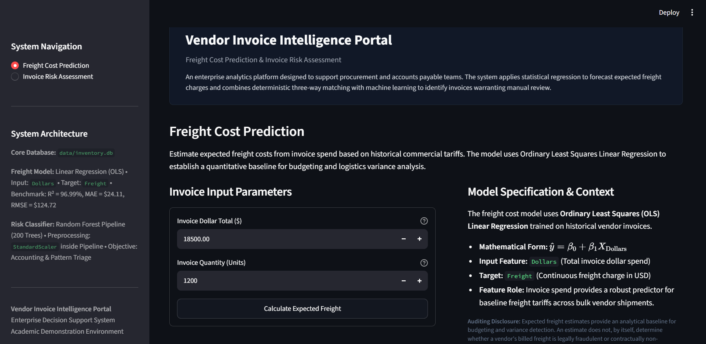
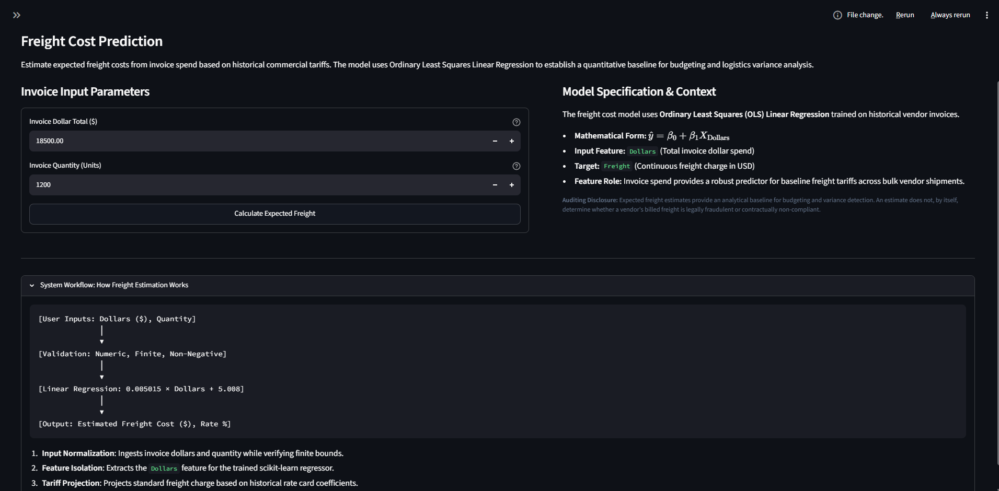

# 📦 Vendor Invoice Intelligence Portal
**Freight Cost Prediction & Invoice Risk Flagging**

An internal analytics and machine learning system for enterprise supply chain operations. The portal provides automated freight charge estimation and early-warning invoice risk assessment to help procurement and finance teams prevent financial leakage, identify accounting mismatches, and prioritize manual invoice reviews.

---

## 📌 Table of Contents

- [Project Overview](#project-overview)
- [System Architecture & Directory Structure](#system-architecture--directory-structure)
- [Database Schema & Data Sources](#database-schema--data-sources)
- [Models & Methodological Framework](#models--methodological-framework)
  - [Freight Cost Prediction Model](#freight-cost-prediction-model)
  - [Invoice Risk Flagging Framework](#invoice-risk-flagging-framework)
- [Feature Status & Implementation Matrix](#feature-status--implementation-matrix)
- [Setup & Operational Runbook](#setup--operational-runbook)
- [Known Limitations & Future Improvements](#known-limitations--future-improvements)

---

<a id="project-overview"></a>
## 📋 1. Project Overview

In accounts payable and supply chain operations, manual verification of vendor invoices across thousands of line items is labor-intensive and error-prone. This system provides two capabilities:

1. **Freight Cost Prediction**: Estimates expected freight charges from invoice dollar totals using the verified **Linear Regression** model, establishing a baseline rate to detect excessive logistics surcharges.
2. **Invoice Risk Flagging**: Evaluates vendor invoices for manual review using a combination of deterministic 3-way accounting checks (comparing billed dollars and quantities against warehouse receipts) and statistical risk pattern classification.

> [!NOTE]
> The freight model predicts expected freight based on invoice spend under the baseline commercial rate card. It does not, by itself, prove legal fraud or contractual breach. Similarly, the risk classifier flags anomalous patterns for human review and must not be described as detecting confirmed fraud.

---

### 📷 Visual Demonstration: Portal Dashboard Overview
*Place your screenshot of the full portal dashboard below (`docs/images/01_portal_dashboard_overview.png`):*

<!--  -->

```
[ SCREENSHOT PLACEHOLDER 1: Vendor Invoice Intelligence Portal — Executive Dashboard ]
(Recommended file path: docs/images/01_portal_dashboard_overview.png)
```

---

<a id="system-architecture--directory-structure"></a>
## 🏗️ 2. System Architecture & Directory Structure

```
Machine Learning Project/
├── app.py                                  # Interactive Streamlit dashboard
├── README.md                               # Project documentation & operational runbook
├── data/
│   └── inventory.db                        # SQLite database (5 tables)
├── freight_cost_prediction/                # Freight regression pipeline
│   ├── __init__.py                         # Package anchor
│   ├── data_preprocessing.py               # Data loading (inventory.db), feature extraction, split
│   ├── model_evaluation.py                 # Regressor definitions (LinearRegression) & corrected RMSE metrics
│   └── train.py                            # Training orchestrator saving to models/
├── invoice_flagging/                       # Invoice risk classification pipeline
│   ├── __init__.py                         # Package anchor
│   ├── data_preprocessing.py               # SQL aggregation CTE, risk labeling, StandardScaler
│   ├── modeling_evaluation.py              # Pipeline (StandardScaler + RandomForest, 5-fold CV)
│   └── train.py                            # Training orchestrator saving pipeline & scaler
├── inference/                              # Standalone prediction modules
│   ├── __init__.py                         # Package anchor
│   ├── predict_freight.py                  # Validated inference wrapper for freight model
│   └── predict_invoice_flag.py             # Validated inference wrapper for risk classifier
├── models/                                 # Serialized model artifacts
│   ├── predict_freight_model.pkl           # LinearRegression artifact (Dollars -> Freight)
│   ├── predict_flag_invoice.pkl            # Trained sklearn Pipeline artifact (StandardScaler + RandomForest)
│   └── scaler.pkl                          # Fitted StandardScaler (5 features)
├── notebooks/                              # Research & evaluation notebooks
│   ├── Predicting Freight Cost.ipynb       # Freight analysis & Linear Regression prototyping
│   ├── Invoice Flagging.ipynb              # Historical exploratory analysis & audit trail
│   └── Invoice_Flagging_Final_Evaluation.ipynb # Leakage-free evaluation & multi-partition holdout audit
├── docs/                                   # Project documentation & visual assets
│   └── images/                             # UI and terminal execution screenshots
└── tests/                                  # Automated test suite (32 tests)
    ├── __init__.py                         # Package anchor
    ├── test_predict_freight.py             # 13 tests: loading, validation, batch, preservation
    ├── test_predict_invoice_flag.py        # 12 tests: loading, features, accounting checks, isolation
    ├── test_pipeline_consistency.py        # 7 tests: paths, RMSE, scalers, pipeline structure, CV isolation
    └── run_all_tests.py                    # Unified test discovery and execution script
```

---

<a id="database-schema--data-sources"></a>
## 🗄️ 3. Database Schema & Data Sources

The primary data store is [`data/inventory.db`](data/inventory.db), an SQLite database containing 5 operational tables supporting procurement and warehouse reconciliation:

| Table | Total Rows | Role in System | Key Columns Used |
|---|---|---|---|
| `vendor_invoice` | 5,543 | Header-level invoice records | `PONumber` (PK, 1:1), `Dollars`, `Quantity`, `Freight`, `Approval`, `InvoiceDate`, `PODate`, `PayDate` |
| `purchases` | 2,372,474 | Line-item warehouse receipts | `PONumber` (FK, 1:M), `Quantity`, `Dollars`, `Brand`, `PODate`, `ReceivingDate` |
| `purchase_prices` | 12,261 | Catalog price references | *Unused in current pipelines* |
| `begin_inventory` | 206,529 | Historical store inventory | *Unused in current pipelines* |
| `end_inventory` | 224,489 | Period-end store inventory | *Unused in current pipelines* |

---

<a id="models--methodological-framework"></a>
## ⚙️ 4. Models & Methodological Framework

<a id="freight-cost-prediction-model"></a>
### 4.1 Freight Cost Prediction Model
* **Algorithm**: Ordinary Least Squares Linear Regression (`sklearn.linear_model.LinearRegression`).
* **Input Feature**: `Dollars` (Invoice dollar amount).
* **Target**: `Freight` (Continuous dollar cost).
* **Artifact**: [`models/predict_freight_model.pkl`](models/predict_freight_model.pkl)
* **Cryptographic SHA-256 Verification**: `2fab0379bde8a5647b0ab72451334fda14d99aef29d3a0fd873b8fae4e705ab3` (verified 100% frozen; zero retraining or alteration).
* **Fitted Linear Equation**:
  $$\text{Expected Freight} = 5.008021 + 0.005015 \times \text{Dollars}$$
* **Rate Card Interpretation**: The model captures a commercial logistics formula of a \$5.00 base charge plus approximately 0.50% (50 cents per \$100) of invoice value.
* **Verified Test Metrics (80/20 Holdout Split, N=1,109)**:
  * **Mean Absolute Error (MAE)**: **\$24.11**
  * **Mean Squared Error (MSE)**: **\$15,555.32**
  * **True Root Mean Squared Error (RMSE)**: **\$124.72** ($\sqrt{\text{MSE}} = \sqrt{15,555.32}$)
  * **Coefficient of Determination (R²)**: **96.99%**
  * **Weighted Absolute Percentage Error (WAPE)**: **8.20%** across total freight spend.
  * **Mean Absolute Percentage Error (MAPE)**: **190.72%** *(Non-zero actuals; see mathematical policy below)*.
* **Metric Policy: Why WAPE is Preferred Over MAPE**:
  * 84 invoices in the holdout split have actual freight under \$1.00 (down to \$0.03).
  * Because the linear intercept enforces a \$5.008 minimum prediction, an invoice with \$0.05 actual freight and \$5.01 predicted freight incurs a single-record error of **9,920%**, severely distorting the unweighted arithmetic mean.
  * In contrast, **WAPE (8.20%)** sums absolute errors across total freight spend ($\sum |y - \hat{y}| / \sum y$), accurately reflecting institutional financial exposure.
* **In-Depth Residual Analysis & Heteroskedasticity**:
  * **Low Spend Tier (< \$500, N=189, 17.0% of invoices)**:
    * The model systematically **overpredicts 97.4% of invoices** (184 of 189) due to the \$5.008 intercept baseline.
    * Mean Actual Freight = **\$1.52** vs. Mean Predicted Freight = **\$6.14** (Mean Residual = -\$4.62, MAE = \$4.99, RMSE = \$5.08).
  * **Medium Spend Tier (\$500 – \$5,000, N=381, 34.4% of invoices)**:
    * Mean Actual Freight = **\$9.67** vs. Mean Predicted Freight = **\$14.43** (Mean Residual = -\$4.76, MAE = \$5.20, RMSE = \$5.65, WAPE = 53.83%).
  * **High Spend Tier (≥ \$5,000, N=539, 48.6% of invoices)**:
    * Unbiased central tendency: Mean Actual Freight = **\$597.86** vs. Mean Predicted Freight = **\$595.98** (Mean Residual = +\$1.88, WAPE = 7.39%).
    * **Heteroskedastic Variance**: Residual dispersion expands significantly with volume (RMSE = **\$178.81**), with heavy positive outlier residuals reaching up to **+\$3,679.86** where expedited freight exceeded the standard linear rate card. High $R^2$ (96.99%) is heavily driven by large dollar variance, while heteroskedasticity indicates that relative confidence bands widen for high-spend orders.

#### 📷 Visual Demonstration: Freight Cost Estimation Interface
*Place your screenshot of the Freight Cost Prediction module and calculation results below (`docs/images/02_freight_cost_prediction_ui.png`):*

<!--  -->

```
[ SCREENSHOT PLACEHOLDER 2: Freight Cost Prediction UI & Estimation Breakdown ]
(Recommended file path: docs/images/02_freight_cost_prediction_ui.png)
```

<a id="invoice-risk-flagging-framework"></a>
### 4.2 Invoice Risk Flagging Framework
The invoice risk pipeline decouples deterministic accounting verification from statistical machine learning classification:

#### 1. Deterministic 3-Way Match Layer (Reconciliation Engine)
Before evaluating statistical probabilities, the pipeline applies exact arithmetic rules comparing invoice headers against warehouse dock receipts:
* **Physical Quantity Discrepancy**: `|Billed Quantity - Received Quantity| > 0` (comparing `invoice_quantity` vs. `total_item_quantity`).
* **Dollar Amount Mismatch**: `|Billed Dollars - Received Dollars| > $5.00` (comparing `invoice_dollars` vs. `total_item_dollars`).

*Deterministic vs. Machine Learning Distinction*: Arithmetic reconciliation verifies exact mathematical discrepancies (`|Billed - Received| > 0` units and `|Billed - Received| > $5.00`); its real-world operational reliability depends directly on warehouse data ingestion quality, dock scan completeness, and the chosen tolerance band (\$5.00). In contrast, the machine learning classifier evaluates non-linear multi-attribute patterns across order size, freight ratio, and receipt volumes to prioritize reviewer attention.

#### 2. Statistical Pattern Classification Layer (Pipeline Model)
* **Architecture**: `sklearn.pipeline.Pipeline` encapsulating `StandardScaler` and `RandomForestClassifier`.
* **Hyperparameters (5-Fold CV Tuning)**: `n_estimators = 200`, `max_depth = None`, `min_samples_split = 5`, `criterion = 'gini'`.
* **Leakage-Safe Preprocessing**: `StandardScaler` is fitted strictly within each cross-validation training fold, preventing validation fold information from leaking into model selection.
* **Exact Input Features (5 variables)**:
  1. `invoice_quantity`: Total billed item units.
  2. `invoice_dollars`: Total billed invoice spend (USD).
  3. `Freight`: Billed shipping and logistics cost (USD).
  4. `total_item_quantity`: Total physical units recorded as received at warehouse.
  5. `total_item_dollars`: Summed line-item receipt valuation (USD).
* **Target Label Generation (Synthetic Ground Truth)**:
  Training labels (`flag_invoice`) were generated using business heuristics rather than historical audit dispute logs:
  $$\text{flag\_invoice} = 1 \iff |\text{invoice\_dollars} - \text{total\_item\_dollars}| > \$5.00 \quad \lor \quad \text{avg\_receiving\_delay} > 10.0\text{ days}$$
  *Heuristic Nature*: Because ground truth labels reflect programmatic heuristics rather than verified fraud, chargebacks, or vendor disputes, the model learns a pattern recognizer for operational review urgency rather than a detector of confirmed dishonesty.

#### 3. Multi-Partition Holdout Evaluation Comparison
To verify that the model's reported metrics are not artifacts of historical test-set viewing, the frozen pipeline architecture was evaluated across multiple independent holdout partitions:

| Evaluation Partition | Split Strategy | Sample Size (Train / Test) | Accuracy | Precision (Flagged) | Recall (Flagged) | F1-Score | ROC-AUC | PR-AUC | Key Evaluation Insight |
|---|---|---|---|---|---|---|---|---|---|
| **Historical Baseline (Seed 42)** | 80/20 Random Stratified | 4,434 / 1,109 | **88.82%** | **95.14%** | **71.35%** | **0.8155** | **0.8721** | **0.8775** | Original benchmark (TN=711, FP=14, FN=110, TP=274). |
| **Fresh Stratified Holdout (Seed 2024)** | 80/20 Fresh Random Stratified | 4,434 / 1,109 | **89.90%** | **97.08%** | **71.89%** | **0.8261** | **0.8715** | **0.8735** | Completely untouched holdout; confirms stable generalization (TN=731, FP=8, FN=104, TP=266). |
| **Vendor-Grouped Holdout** | `GroupShuffleSplit` on `VendorNumber` | 4,388 / 1,155 | **87.97%** | **91.86%** | **70.21%** | **0.7959** | **0.8611** | **0.8588** | Evaluates **26 completely unseen vendors** (zero vendor overlap). High precision confirms vendor-invariance. |
| **Chronological Partition (Diagnostic)** | Last 20% on `InvoiceDate` | 4,434 / 1,109 | 92.06% | 100.00% | 91.99% | 0.9583 | 0.9897 | 0.9999 | Diagnostic only: 99.01% flag rate due to Q4 2024 data ingestion shift; unsuitable as unbiased benchmark. |

#### 4. Root Cause of False Negatives (Omission of Receiving Delay)
Across the full database, 27.84% of flagged invoices (515 out of 1,850) were triggered **solely** by delivery delays (`avg_receiving_delay > 10.0` days) with zero dollar discrepancy.
* In the held-out test split, 99 invoices fall into this delay-only category.
* Because `avg_receiving_delay` was **deliberately omitted from the classifier feature set**, the model cannot directly observe warehouse dock delivery lead times.
* Consequently, the classifier misses **98 out of 99 delay-only invoices** (98.99% miss rate on delivery delays).
* These 98 missed delay cases account for **89.09% of all model false negatives** (98 out of 110 FNs).
* In contrast, on invoices with actual dollar discrepancies, the model achieves **95.79% recall** (274 out of 286 caught).
* *Operational Recommendation*: Accounts payable workflows must evaluate warehouse receiving delay flags deterministically rather than expecting the 5-feature risk classifier to infer dock bottlenecks.

#### 5. Historical Notebook Leakage & Audit Isolation Trail
The historical research notebook ([`notebooks/Invoice Flagging.ipynb`](notebooks/Invoice%20Flagging.ipynb)) was fully audited and preserved as an exploratory audit trail. It contained four methodological limitations:
1. **Full-Dataset Statistical Tests**: Correlation analysis (Cell 13) and two-sample t-tests (Cells 15–17) were conducted across all 5,543 records prior to train/test partitioning, discarding `days_to_pay` and `total_brands` based on global data.
2. **Repeated Test-Set Feature Pruning**: Test set metrics guided the decision to prune features from 7 to 5 (Cell 32).
3. **Cross-Validation Preprocessing Leakage**: Global scaling across the entire training partition prior to `GridSearchCV`.
4. **Transposed Confusion Matrix**: Exploratory Cell 38 called `confusion_matrix(pred, y_test)`, swapping false positives and false negatives.

**Complete Resolution**: The dedicated audit notebook ([`notebooks/Invoice_Flagging_Final_Evaluation.ipynb`](notebooks/Invoice_Flagging_Final_Evaluation.ipynb)) cleanly resolves all four issues:
- Strictly splits the dataset before executing any exploratory statistics.
- Executes two-sample Welch's t-tests solely on the training partition (`X_train_raw`).
- Encapsulates `StandardScaler` inside the `sklearn.pipeline.Pipeline` with 5-fold CV hyperparameter tuning.
- Freezes all tuning decisions before evaluating the holdout test set.
- Enforces standard `confusion_matrix(y_true, y_pred)` orientation.

#### 6. System Governance & Operational Scope
> [!IMPORTANT]
> The invoice risk classifier is a **decision-support prototype designed for audit triage and manual review prioritization**. It does **not** detect confirmed fraud, legal malfeasance, or criminal intent. The training labels reflect heuristic operational flags, and the database contains zero verified fraud, chargeback, or litigation records. All flagged records must be reconciled by accounts payable specialists before any commercial action is taken.

---

<a id="feature-status--implementation-matrix"></a>
## 📊 5. Feature Status & Implementation Matrix

| Capability / Feature | Category | Implementation Status | Description |
|---|---|---|---|
| Linear Regression Freight Inference | Freight | **Implemented & Tested** | Predicts expected freight from `Dollars`. Rejects negative/null values. Verified with 13 unit tests. |
| Freight Input Preservation | Freight | **Implemented & Tested** | Preserves original inputs (such as `Quantity`) when passed alongside `Dollars`. |
| Corrected Evaluation RMSE | Freight | **Implemented & Tested** | Replaced raw MSE reporting bug with true $\sqrt{\text{MSE}}$ in evaluation scripts. |
| 3-Way Accounting Matching | Risk Flagging | **Implemented & Tested** | Detects billed vs. received dollar discrepancies (> \$5.00) and quantity variances. |
| Random Forest Pipeline Inference | Risk Flagging | **Implemented & Tested** | Encapsulated sklearn Pipeline (StandardScaler + RandomForest) with 5-fold CV leakage-free tuning. |
| Dynamic Path Resolution | System Core | **Implemented & Tested** | Replaced hardcoded `/Users/DELL/...` paths with `pathlib.Path` relative to project root. |
| Streamlit Interactive Portal | UI / Dashboard | **Implemented & Tested** | Provides web forms for both modules with defensive error handling and clear reason breakdowns. |
| Delivery Delay Feature at Inference | Risk Flagging | **Implemented but Not Validated** | `avg_receiving_delay` is present in SQL aggregations but not collected on the UI form. |
| Delegation of Authority (> $250k) | Governance | **Implemented but Not Validated** | Database reflects executive sign-off (`Frank Delahunt`) on orders $\ge 250,000$ USD; rule codified in framework. |
| Automated ERP / WMS Ingestion | System Core | **Planned but Not Implemented** | Direct webhook/API ingestion of incoming EDI 810 invoices. |
| Anomaly Isolation Forest | Risk Flagging | **Planned but Not Implemented** | Unsupervised multi-attribute outlier scoring on vendor baselines. |

---

<a id="setup--operational-runbook"></a>
## 🚀 6. Setup & Operational Runbook

### Environment Requirements
* Python 3.10+ (tested on Python 3.13)
* Dependencies: `scikit-learn`, `pandas`, `numpy`, `joblib`, `streamlit`

### Running Automated Tests
Execute the complete test suite (32 tests across all modules):
```powershell
python tests/run_all_tests.py
```
*Expected Terminal Output*:
```
Ran 32 tests in 2.567s
OK - 32 tests run. Failures: 0, Errors: 0
```

### Running Standalone Inference Scripts

#### 1. Freight Cost Prediction
```powershell
python inference/predict_freight.py
```
*Expected Output*:
```
Freight Cost Predictions:
   Dollars  Predicted_Freight
0    18500               98.0
1     9000               50.0
2     3000               20.0
3      200                6.0
```

#### 2. Invoice Risk Flagging
```powershell
python inference/predict_invoice_flag.py
```
*Expected Output*:
```
Invoice Flagging Predictions:
   invoice_dollars  total_item_dollars  Predicted_Flag  Risk_Score  Accounting_Discrepancy_Detected   Review_Recommendation
0           352.95             2476.00               1      0.9850                             True  Manual Review Required
1         18500.00            18500.00               0      0.0320                            False     Standard Processing
```

### Launching the Streamlit Web Application
```powershell
streamlit run app.py
```
Once launched, navigate to `http://localhost:8501` to access the interactive portal.

---

<a id="known-limitations--future-improvements"></a>
## ⚠️ 7. Known Limitations & Future Improvements

1. **Synthetic Heuristic Labels**:
   * The risk classifier was trained on heuristic pseudo-labels (`|invoice_dollars - total_item_dollars| > 5` and `avg_receiving_delay > 10`), not verified audit failure records.
   * *Future Improvement*: Ingest historical accounts payable audit logs or vendor credit adjustments to supervise the model on genuine commercial disputes.
2. **Freight Single-Variable Baseline**:
   * While the Linear Regression model achieves a high R² (96.99%) across the macro spend distribution, it uses an additive intercept (\$5.01) that overpredicts small invoices (< \$500) on a percentage basis.
   * *Future Improvement*: Evaluate piecewise rate cards or shipment-tier segmented models when authorized by logistics business owners.
3. **Delivery Delay Collection**:
   * Receiving delay accounts for 27.8% of synthetic risk flags, but receiving dates are not captured in the current Streamlit front-end.
   * *Future Improvement*: Add purchase order date and warehouse receiving date fields to the review form to enable lead-time SLA checks.

